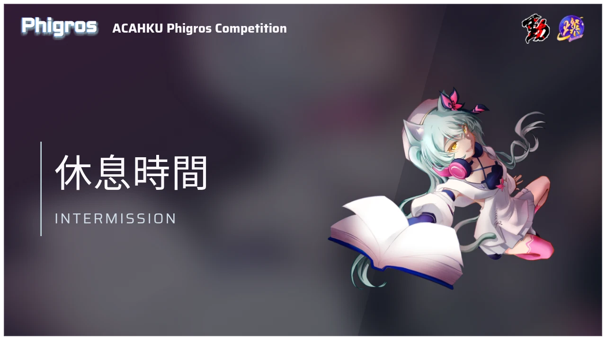

# ACAHKU Phigros Competition 2026

The production console and OBS graphics for the 2026 Phigros competition organised by the Animation and Comics Association, HKU.

**English** · [繁體中文](README.zh-TW.md)

[Quick start](#quick-start) · [Live operation](#live-operation) · [OBS setup](#obs-setup) · [Reference](#reference)



One local server connects the crew and the broadcast. Main control directs the show, scorekeepers record results, and the host runs the song draw. The event preset covers three-song Challenge Mode qualifiers, an eight-player double-elimination bracket, intermission, and a three-song Grand Final with its own reveal video and effects.

## Quick start

Install Git and **Node.js 24.22.1 or later in the 24.x series**, then run:

```sh
git clone https://github.com/VivoWalker/ACAHKU-Phigros-Competition-2026.git
cd ACAHKU-Phigros-Competition-2026
npm ci
npm start
```

Leave the server running and use the matching pairing codes printed in the terminal.

| Role | Local address | Responsibility |
| --- | --- | --- |
| Main control | <http://localhost:3000/control/> | Set up the event, cue scenes, confirm results and manage backups. |
| Scorekeeper | <http://localhost:3000/scorekeeper/> | Record results for the current competitors. |
| Host | <http://localhost:3000/host/> | Draw candidates, enter both bans and draw the two match songs in regular rounds. |
| OBS Browser Source | <http://localhost:3000/overlay/live.html> | Follow the scene selected in main control. |

For a tablet or a second computer on the same network, use the server’s LAN address in place of `localhost`. The show runs over the local network with bundled assets after installation.

## Live operation

1. **Prepare the event.** Verify the preset song library in **Event & library**. In **Qualifiers**, replace the sample roster, use **Auto** to select the format, and draw player numbers. Plan A covers up to 20 entrants with a first round and a revival round. Plan B splits larger fields by odd and even player numbers. Each round or group advances four.
2. **Run qualifiers.** Call batches of up to three in **Live production**. After each Challenge Mode set, save the three song statistics and the official total shown by the game. Resolve ties that affect the top-four cutoff before confirming advancement.
3. **Take intermission.** Show the rest screen, then cue the Arcaea trailer from its separate panel when ready. The trailer plays once and returns to the rest screen.
4. **Run the bracket.** Select the match in main control. For each regular match, the host draws six candidates, records one ban per player, and draws two songs for sequential previews. Cue each song from preparation to gameplay, processing and results. Confirm the match result to update the bracket. Tied totals go to mean ACC and, if still tied, a separate tiebreak.
5. **Close the show.** Announce the first two Grand Final songs, then use the finale controls for the third-song reveal video and effects. Confirm the result from all three songs, then publish the standings. The podium lists first through third individually, with unordered groups for fourth through eighth and ninth onward.

The next action in **Live production** follows the current scene. Saving scores keeps the operator in control of when results go on air.

## OBS setup

1. Create a **1920 × 1080** Browser Source with the live overlay URL and place it above the gameplay sources. Keep the source active across scene changes.
2. In single view, fit one **4:3 webcam picture per player** to its transparent window. The layout is calibrated for a **960 × 720 picture at 30 fps**. Qualifiers use up to three slots, and bracket matches use two.
3. In main control, save the OBS source names and check each feed in the OBS preview. The crew changes capture sources and OBS scenes manually.
4. Enable **Control audio via OBS** on the program Browser Source. The shared master volume covers previews, music and video. Staff previews are silent, and extra Browser Sources can use `?audio=0`.

## Rehearse and safeguard the event

Launch a temporary fixture for the qualification-cutoff tiebreak on port 3001:

```sh
npm run test:manual -- --case Q05
```

The terminal prints the rehearsal URLs, credentials and expected steps. Use `npm run test:manual -- --list` to browse the other checkpoints.

Live scores, backups, pairing credentials and uploaded media are stored in `data/`. Before moving or upgrading a live event, stop the server and copy the whole directory. **Export state backup** in **Event & library** downloads a JSON snapshot of tournament progress.

## Reference

| Guide | Use it for |
| --- | --- |
| [Operator reference](docs/operator-reference.md) | Capture alignment, source checks, referee tools, recovery and development commands. |
| [Competition rules](docs/competition-rules.md) and [proposal audit](docs/proposal-rule-audit.md) | Format, adjudication and decisions recorded against the proposal. |
| [Grand Final presentation](docs/grand-final-presentation.md) | Song reveals, the final PV and the purification sequence. |
| [Manual rehearsal library](test/manual-saves/README.md) | Step-by-step checks for ties, advancement, intermission and the final. |
| [Broadcast media](public/assets/broadcast-videos/README.md) and [song previews](public/assets/song-preview/README.md) | Media sources, playback details and asset preparation. |

Run `npm test` for the server and tournament checks. [GitHub Actions](https://github.com/VivoWalker/ACAHKU-Phigros-Competition-2026/actions/workflows/test.yml) also runs the Chromium regressions.
