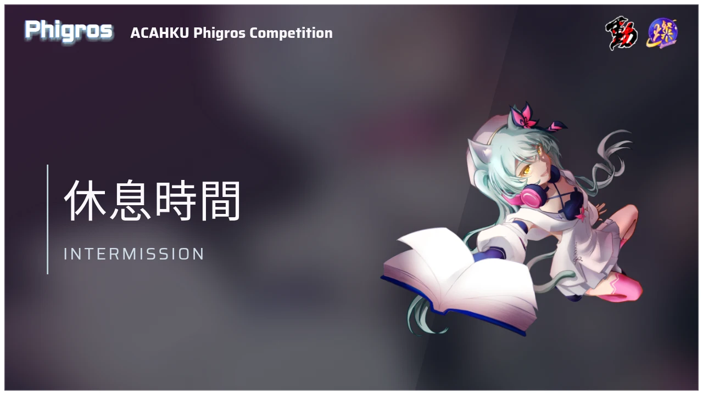

# ACAHKU Phigros Competition 2026

香港大學動漫聯盟 2026 年 Phigros 比賽的賽事操作台與 OBS 直播圖層。

[English](README.md) · **繁體中文**

[快速開始](#快速開始) · [現場操作](#現場操作) · [OBS 設定](#obs-設定) · [參考文件](#參考文件)



由一台本機伺服器串連工作人員與直播畫面。主控負責導播，計分員登錄成績，主持人操作抽曲。賽事預設涵蓋三首曲目的 Challenge Mode 預選賽、八人雙淘汰賽、中場休息，以及含專屬公布影片與特效的三首制總決賽。

## 快速開始

安裝 Git 及 **Node.js 24.22.1 或更新的 24.x 版本**，然後執行：

```sh
git clone https://github.com/VivoWalker/ACAHKU-Phigros-Competition-2026.git
cd ACAHKU-Phigros-Competition-2026
npm ci
npm start
```

保持伺服器運行，並使用終端顯示的對應角色配對碼登入。

| 角色 | 本機網址 | 職責 |
| --- | --- | --- |
| 主控 | <http://localhost:3000/control/> | 設定賽事、切換播出畫面、確認賽果及管理備份。 |
| 計分員 | <http://localhost:3000/scorekeeper/> | 登錄當前選手的成績。 |
| 主持人 | <http://localhost:3000/host/> | 在常規場次抽取候選曲、登錄雙方 BAN 曲，再抽出兩首比賽曲。 |
| OBS Browser Source | <http://localhost:3000/overlay/live.html> | 跟隨主控選擇的播出畫面。 |

在同一網絡使用平板或另一台電腦時，將 `localhost` 換成伺服器的區域網絡 IP。完成安裝後，直播可使用隨附素材在區域網絡內運行。

## 現場操作

1. **賽前準備。** 在 **Event & library** 核對預設曲庫，在 **Qualifiers** 替換示範名單，以 **Auto** 選擇賽制，再抽選選手編號。20 人或以下採用 Plan A，分第一輪與復活賽。超過 20 人採用 Plan B，按選手編號分為奇數組及偶數組。每輪或每組各取四名晉級。
2. **預選賽。** 在 **Live production** 依批次安排選手，每批最多三人。完成 Challenge Mode 後，保存三首曲目的統計及遊戲顯示的官方總分。確認晉級前，先處理影響前四名晉級線的同分。
3. **中場休息。** 先顯示休息畫面，再於適當時機使用獨立的 Arcaea 預告面板播放影片。影片播放一次後自動返回休息畫面。
4. **雙淘汰賽。** 主控指定場次。常規場次由主持人抽出六首候選曲，雙方各 BAN 一首，再抽出兩首比賽曲依序預覽。每首依序進入準備、比賽、統計及公布成績，確認整輪賽果後更新對陣。總分相同時以平均 ACC 判定，仍同分則進行加賽。
5. **總決賽與總排名。** 依序公布前兩首曲目，再用終章控制播放第三首公布影片並操作特效。核對三首成績後確認賽果，然後公布總排名。冠、亞、季軍各有獨立名次，第 4 至第 8 名與第 9 名起各成一組，組內不分先後。

**Live production** 會依照當前畫面提供下一步操作。成績保存後，由主控選擇公布時機。

## OBS 設定

1. 新增一個 **1920 × 1080** 的 Browser Source，使用上表的直播圖層網址，並置於遊戲影像來源上方。切換場景時，保持此來源運行。
2. 單畫面模式下，為每位選手將一路 **4:3 攝影機畫面**對齊透明視窗。版面以 **960 × 720、30 fps** 的畫面校準。預選賽最多三個選手槽，雙淘汰賽每場兩個。
3. 在主控保存 OBS 來源名稱，再於 OBS 預覽逐一核對實際畫面。影像來源與 OBS 場景由工作人員手動切換。
4. 為正式播出的 Browser Source 啟用 **Control audio via OBS**。預覽音樂、背景音樂與影片共用主音量。工作人員預覽為靜音，額外的 Browser Source 可加上 `?audio=0`。

## 綵排與存檔

用以下指令在 3001 連接埠載入「晉級線同分」的臨時綵排存檔：

```sh
npm run test:manual -- --case Q05
```

終端會列出綵排網址、配對碼和預期步驟。以 `npm run test:manual -- --list` 查看其他案例。

正式賽事的分數、備份、配對資料及已上傳媒體存於 `data/`。遷移或升級前，請停止伺服器並複製整個資料夾。**Event & library** 的 **Export state backup** 可下載賽事進度的 JSON 快照。

## 參考文件

| 文件 | 內容 |
| --- | --- |
| [完整操作手冊](docs/operator-reference.md) | 影像對齊、來源核對、裁判工具、復原與開發指令。 |
| [比賽規則](docs/competition-rules.md)及[提案核對](docs/proposal-rule-audit.md) | 賽制、裁判流程，以及依提案記錄的判定。 |
| [總決賽演出](docs/grand-final-presentation.md) | 曲目公布、決賽影片與淨化演出。 |
| [綵排存檔](test/manual-saves/README.md) | 同分、晉級、中場休息及總決賽的逐步檢查。 |
| [播出媒體](public/assets/broadcast-videos/README.md)及[曲目預覽](public/assets/song-preview/README.md) | 媒體來源、播放方式與素材準備。 |

以 `npm test` 執行伺服器與賽事規則檢查。[GitHub Actions](https://github.com/VivoWalker/ACAHKU-Phigros-Competition-2026/actions/workflows/test.yml) 亦會執行 Chromium 瀏覽器回歸測試。
